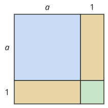
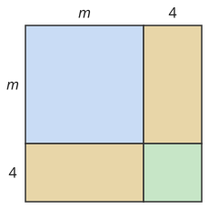
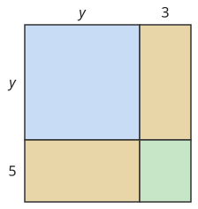
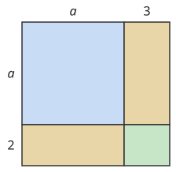
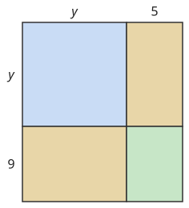
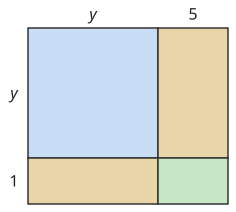
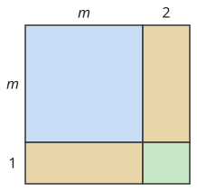

# Beispiele: t8-binom-geometrie (Version 1)

> Automatisch erzeugt mit `npm run beispiele`. Bitte nicht von Hand bearbeiten.
> Zur Sichtprüfung: Stimmen Aufgaben, Lösungen, Hilfen und Fehloptionen? Wirkt der Schwierigkeitsgrad passend?

## AFB I · Eingabe

### 1. Das Quadrat hat die Seitenlänge a + 1. Gib seinen Flächeninhalt als Summe der Teilflächen an (zusammengefasst).  (Seed 0)

**Aufgabe:** (a + 1)²

**Lösung:** a² + 2a + 1

Hilfen

1. **Denkanstoß:** Die Figur besteht aus vier Teilflächen. Berechne jede einzeln (Breite mal Höhe) und addiere sie.
2. **Ansatz:** (a + 1)² = a² + a + a + 1
3. **Lösungsweg:**
   - (a + 1)² = a² + a + a + 1
   - = a² + 2a + 1

### 2. Das Quadrat hat die Seitenlänge y + 1. Gib seinen Flächeninhalt als Summe der Teilflächen an (zusammengefasst).  (Seed 1)

**Aufgabe:** (y + 1)²

**Lösung:** y² + 2y + 1

Hilfen

1. **Denkanstoß:** Die Figur besteht aus vier Teilflächen. Berechne jede einzeln (Breite mal Höhe) und addiere sie.
2. **Ansatz:** (y + 1)² = y² + y + y + 1
3. **Lösungsweg:**
   - (y + 1)² = y² + y + y + 1
   - = y² + 2y + 1

### 3. Das Quadrat hat die Seitenlänge y + 4. Gib seinen Flächeninhalt als Summe der Teilflächen an (zusammengefasst).  (Seed 2)

**Aufgabe:** (y + 4)²

**Lösung:** y² + 8y + 16

Hilfen

1. **Denkanstoß:** Die Figur besteht aus vier Teilflächen. Berechne jede einzeln (Breite mal Höhe) und addiere sie.
2. **Ansatz:** (y + 4)² = y² + 4y + 4y + 16
3. **Lösungsweg:**
   - (y + 4)² = y² + 4y + 4y + 16
   - = y² + 8y + 16

### 4. Das Quadrat hat die Seitenlänge y + 1. Gib seinen Flächeninhalt als Summe der Teilflächen an (zusammengefasst).  (Seed 3)

**Aufgabe:** (y + 1)²

**Lösung:** y² + 2y + 1

Hilfen

1. **Denkanstoß:** Die Figur besteht aus vier Teilflächen. Berechne jede einzeln (Breite mal Höhe) und addiere sie.
2. **Ansatz:** (y + 1)² = y² + y + y + 1
3. **Lösungsweg:**
   - (y + 1)² = y² + y + y + 1
   - = y² + 2y + 1

### 5. Das Quadrat hat die Seitenlänge m + 4. Gib seinen Flächeninhalt als Summe der Teilflächen an (zusammengefasst).  (Seed 4)

**Aufgabe:** (m + 4)²

**Lösung:** m² + 8m + 16

Hilfen

1. **Denkanstoß:** Die Figur besteht aus vier Teilflächen. Berechne jede einzeln (Breite mal Höhe) und addiere sie.
2. **Ansatz:** (m + 4)² = m² + 4m + 4m + 16
3. **Lösungsweg:**
   - (m + 4)² = m² + 4m + 4m + 16
   - = m² + 8m + 16

## AFB I · Auswahl

### 6. Das Quadrat hat die Seitenlänge a + 1. Welcher Term beschreibt seinen Flächeninhalt als Summe der Teilflächen?  (Seed 0)

**Aufgabe:** (a + 1)²

- A) a² + 1  ❌ Fehlertyp PO
- B) a² + a + 1  ❌ Fehlertyp KL
- C) a² + 2a + 1  ✅ richtig

**Lösung:** a² + 2a + 1

Hilfen

1. **Denkanstoß:** Die Figur besteht aus vier Teilflächen. Berechne jede einzeln (Breite mal Höhe) und addiere sie.
2. **Ansatz:** (a + 1)² = a² + a + a + 1
3. **Lösungsweg:**
   - (a + 1)² = a² + a + a + 1
   - = a² + 2a + 1

### 7. Das Quadrat hat die Seitenlänge y + 1. Welcher Term beschreibt seinen Flächeninhalt als Summe der Teilflächen?  (Seed 1)

**Aufgabe:** (y + 1)²

- A) y² + 2y + 1  ✅ richtig
- B) y² + y + 1  ❌ Fehlertyp KL
- C) y² + 1  ❌ Fehlertyp PO

**Lösung:** y² + 2y + 1

Hilfen

1. **Denkanstoß:** Die Figur besteht aus vier Teilflächen. Berechne jede einzeln (Breite mal Höhe) und addiere sie.
2. **Ansatz:** (y + 1)² = y² + y + y + 1
3. **Lösungsweg:**
   - (y + 1)² = y² + y + y + 1
   - = y² + 2y + 1

### 8. Das Quadrat hat die Seitenlänge y + 4. Welcher Term beschreibt seinen Flächeninhalt als Summe der Teilflächen?  (Seed 2)

**Aufgabe:** (y + 4)²

- A) y² + 4y + 16  ❌ Fehlertyp KL
- B) y² + 16  ❌ Fehlertyp PO
- C) y² + 8y + 16  ✅ richtig

**Lösung:** y² + 8y + 16

Hilfen

1. **Denkanstoß:** Die Figur besteht aus vier Teilflächen. Berechne jede einzeln (Breite mal Höhe) und addiere sie.
2. **Ansatz:** (y + 4)² = y² + 4y + 4y + 16
3. **Lösungsweg:**
   - (y + 4)² = y² + 4y + 4y + 16
   - = y² + 8y + 16

### 9. Das Quadrat hat die Seitenlänge y + 1. Welcher Term beschreibt seinen Flächeninhalt als Summe der Teilflächen?  (Seed 3)

**Aufgabe:** (y + 1)²

- A) y² + y + 1  ❌ Fehlertyp KL
- B) y² + 2y + 1  ✅ richtig
- C) y² + 1  ❌ Fehlertyp PO

**Lösung:** y² + 2y + 1

Hilfen

1. **Denkanstoß:** Die Figur besteht aus vier Teilflächen. Berechne jede einzeln (Breite mal Höhe) und addiere sie.
2. **Ansatz:** (y + 1)² = y² + y + y + 1
3. **Lösungsweg:**
   - (y + 1)² = y² + y + y + 1
   - = y² + 2y + 1

### 10. Das Quadrat hat die Seitenlänge m + 4. Welcher Term beschreibt seinen Flächeninhalt als Summe der Teilflächen?  (Seed 4)

**Aufgabe:** (m + 4)²

- A) m² + 16  ❌ Fehlertyp PO
- B) m² + 4m + 16  ❌ Fehlertyp KL
- C) m² + 8m + 16  ✅ richtig

**Lösung:** m² + 8m + 16

Hilfen

1. **Denkanstoß:** Die Figur besteht aus vier Teilflächen. Berechne jede einzeln (Breite mal Höhe) und addiere sie.
2. **Ansatz:** (m + 4)² = m² + 4m + 4m + 16
3. **Lösungsweg:**
   - (m + 4)² = m² + 4m + 4m + 16
   - = m² + 8m + 16

## AFB II · Eingabe

### 11. Das Rechteck hat die Seitenlängen a + 3 und a + 2. Gib seinen Flächeninhalt als Summe der Teilflächen an (zusammengefasst).  (Seed 0)

**Aufgabe:** (a + 3)·(a + 2)

**Lösung:** a² + 5a + 6

Hilfen

1. **Denkanstoß:** Die Figur besteht aus vier Teilflächen. Berechne jede einzeln (Breite mal Höhe) und addiere sie.
2. **Ansatz:** (a + 3)·(a + 2) = a² + 3a + 2a + 6
3. **Lösungsweg:**
   - (a + 3)·(a + 2) = a² + 3a + 2a + 6
   - = a² + 5a + 6

### 12. Das Rechteck hat die Seitenlängen y + 5 und y + 9. Gib seinen Flächeninhalt als Summe der Teilflächen an (zusammengefasst).  (Seed 1)

**Aufgabe:** (y + 5)·(y + 9)

**Lösung:** y² + 14y + 45

Hilfen

1. **Denkanstoß:** Die Figur besteht aus vier Teilflächen. Berechne jede einzeln (Breite mal Höhe) und addiere sie.
2. **Ansatz:** (y + 5)·(y + 9) = y² + 5y + 9y + 45
3. **Lösungsweg:**
   - (y + 5)·(y + 9) = y² + 5y + 9y + 45
   - = y² + 14y + 45

### 13. Das Rechteck hat die Seitenlängen y + 3 und y + 5. Gib seinen Flächeninhalt als Summe der Teilflächen an (zusammengefasst).  (Seed 2)

**Aufgabe:** (y + 3)·(y + 5)

**Lösung:** y² + 8y + 15

Hilfen

1. **Denkanstoß:** Die Figur besteht aus vier Teilflächen. Berechne jede einzeln (Breite mal Höhe) und addiere sie.
2. **Ansatz:** (y + 3)·(y + 5) = y² + 3y + 5y + 15
3. **Lösungsweg:**
   - (y + 3)·(y + 5) = y² + 3y + 5y + 15
   - = y² + 8y + 15

### 14. Das Rechteck hat die Seitenlängen y + 5 und y + 1. Gib seinen Flächeninhalt als Summe der Teilflächen an (zusammengefasst).  (Seed 3)

**Aufgabe:** (y + 5)·(y + 1)

**Lösung:** y² + 6y + 5

Hilfen

1. **Denkanstoß:** Die Figur besteht aus vier Teilflächen. Berechne jede einzeln (Breite mal Höhe) und addiere sie.
2. **Ansatz:** (y + 5)·(y + 1) = y² + 5y + y + 5
3. **Lösungsweg:**
   - (y + 5)·(y + 1) = y² + 5y + y + 5
   - = y² + 6y + 5

### 15. Das Rechteck hat die Seitenlängen m + 2 und m + 1. Gib seinen Flächeninhalt als Summe der Teilflächen an (zusammengefasst).  (Seed 4)

**Aufgabe:** (m + 2)·(m + 1)

**Lösung:** m² + 3m + 2

Hilfen

1. **Denkanstoß:** Die Figur besteht aus vier Teilflächen. Berechne jede einzeln (Breite mal Höhe) und addiere sie.
2. **Ansatz:** (m + 2)·(m + 1) = m² + 2m + m + 2
3. **Lösungsweg:**
   - (m + 2)·(m + 1) = m² + 2m + m + 2
   - = m² + 3m + 2

## AFB II · Auswahl

### 16. Das Rechteck hat die Seitenlängen a + 3 und a + 2. Welcher Term beschreibt seinen Flächeninhalt als Summe der Teilflächen?  (Seed 0)

**Aufgabe:** (a + 3)·(a + 2)

- A) a² + 5a + 6  ✅ richtig
- B) a² + 3a + 6  ❌ Fehlertyp KL
- C) a² + 2a + 6  ❌ Fehlertyp KL
- D) a² + 6  ❌ Fehlertyp PO

**Lösung:** a² + 5a + 6

Hilfen

1. **Denkanstoß:** Die Figur besteht aus vier Teilflächen. Berechne jede einzeln (Breite mal Höhe) und addiere sie.
2. **Ansatz:** (a + 3)·(a + 2) = a² + 3a + 2a + 6
3. **Lösungsweg:**
   - (a + 3)·(a + 2) = a² + 3a + 2a + 6
   - = a² + 5a + 6

### 17. Das Rechteck hat die Seitenlängen y + 5 und y + 9. Welcher Term beschreibt seinen Flächeninhalt als Summe der Teilflächen?  (Seed 1)

**Aufgabe:** (y + 5)·(y + 9)

- A) y² + 5y + 45  ❌ Fehlertyp KL
- B) y² + 45  ❌ Fehlertyp PO
- C) y² + 14y + 45  ✅ richtig
- D) y² + 9y + 45  ❌ Fehlertyp KL

**Lösung:** y² + 14y + 45

Hilfen

1. **Denkanstoß:** Die Figur besteht aus vier Teilflächen. Berechne jede einzeln (Breite mal Höhe) und addiere sie.
2. **Ansatz:** (y + 5)·(y + 9) = y² + 5y + 9y + 45
3. **Lösungsweg:**
   - (y + 5)·(y + 9) = y² + 5y + 9y + 45
   - = y² + 14y + 45

### 18. Das Rechteck hat die Seitenlängen y + 3 und y + 5. Welcher Term beschreibt seinen Flächeninhalt als Summe der Teilflächen?  (Seed 2)

**Aufgabe:** (y + 3)·(y + 5)

- A) y² + 3y + 15  ❌ Fehlertyp KL
- B) y² + 8y + 15  ✅ richtig
- C) y² + 15  ❌ Fehlertyp PO
- D) y² + 5y + 15  ❌ Fehlertyp KL

**Lösung:** y² + 8y + 15

Hilfen

1. **Denkanstoß:** Die Figur besteht aus vier Teilflächen. Berechne jede einzeln (Breite mal Höhe) und addiere sie.
2. **Ansatz:** (y + 3)·(y + 5) = y² + 3y + 5y + 15
3. **Lösungsweg:**
   - (y + 3)·(y + 5) = y² + 3y + 5y + 15
   - = y² + 8y + 15

### 19. Das Rechteck hat die Seitenlängen y + 5 und y + 1. Welcher Term beschreibt seinen Flächeninhalt als Summe der Teilflächen?  (Seed 3)

**Aufgabe:** (y + 5)·(y + 1)

- A) y² + 5y + 5  ❌ Fehlertyp KL
- B) y² + 6y + 5  ✅ richtig
- C) y² + 5  ❌ Fehlertyp PO
- D) y² + y + 5  ❌ Fehlertyp KL

**Lösung:** y² + 6y + 5

Hilfen

1. **Denkanstoß:** Die Figur besteht aus vier Teilflächen. Berechne jede einzeln (Breite mal Höhe) und addiere sie.
2. **Ansatz:** (y + 5)·(y + 1) = y² + 5y + y + 5
3. **Lösungsweg:**
   - (y + 5)·(y + 1) = y² + 5y + y + 5
   - = y² + 6y + 5

### 20. Das Rechteck hat die Seitenlängen m + 2 und m + 1. Welcher Term beschreibt seinen Flächeninhalt als Summe der Teilflächen?  (Seed 4)

**Aufgabe:** (m + 2)·(m + 1)

- A) m² + 2m + 2  ❌ Fehlertyp KL
- B) m² + m + 2  ❌ Fehlertyp KL
- C) m² + 2  ❌ Fehlertyp PO
- D) m² + 3m + 2  ✅ richtig

**Lösung:** m² + 3m + 2

Hilfen

1. **Denkanstoß:** Die Figur besteht aus vier Teilflächen. Berechne jede einzeln (Breite mal Höhe) und addiere sie.
2. **Ansatz:** (m + 2)·(m + 1) = m² + 2m + m + 2
3. **Lösungsweg:**
   - (m + 2)·(m + 1) = m² + 2m + m + 2
   - = m² + 3m + 2

