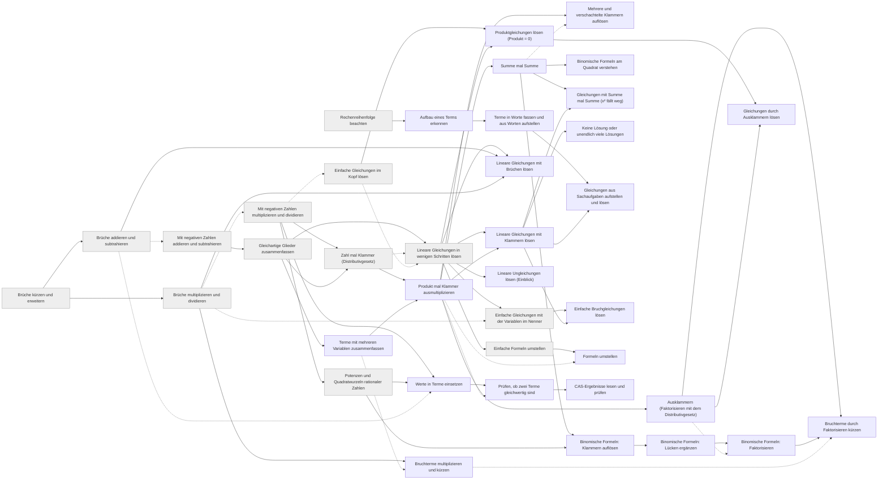

# Übersicht: Gym Kl. 8 – „Arbeiten mit Termen und Gleichungen“

> Automatisch aus den Dateien in `inhalte/` erzeugt – bitte nicht von Hand bearbeiten.
> Status: **fachlich geprüft**

Lehrplan: Gymnasium Mathematik, Kl. 8, LB 1 (24 Ustd.), S. 20.

## Lernziele laut Lehrplan

- **Beherrschen des Umgangs mit Variablen und Termen beim Lösen von linearen Gleichungen**
  - Erkennen der Struktur von Termen
  - Umformen von einfachen Termen und Gleichungen ohne Hilfsmittel
  - binomische Formeln
- **Kennen der Verwendung von CAS beim Umformen komplexerer Terme und Gleichungen**
- **Einblick gewinnen in das Lösen von Ungleichungen**

## Level und Bausteine

AFB = Anforderungsbereich · oH = ohne Hilfsmittel · Darstellung: sym = symbolisch, graf = grafisch, tab = Tabelle, text = Text/Sachaufgabe

### Level 1: Terme lesen

| Baustein | Inhalt | AFB | oH | Darstellung | Fehlertypen | braucht |
|---|---|---|---|---|---|---|
| Aufbau eines Terms erkennen | Erkennen, ob ein Term insgesamt eine Summe, Differenz, ein Produkt oder ein Quotient ist, auch bei verknüpften Termen (z. B. Produkt aus Zahl und Summe); Term ↔ Rechenbaum. | I/II | ja | sym, graf | VR | **Rechenreihenfolge beachten** |
| Terme in Worte fassen und aus Worten aufstellen | Wortbeschreibung ↔ Term (z. B. „das Dreifache der Summe aus einer Zahl und 2“), einfache Sachsituationen durch Terme beschreiben; Bedeutung einer Variablen angeben. | I/II | ja | text, sym | TV, VR, KL | **Aufbau eines Terms erkennen** |
| Werte in Terme einsetzen | Termwerte berechnen, auch mit negativen Zahlen und Brüchen; Wertetabellen ausfüllen. | I/II | ja | sym, tab | VZ, VR, PO, BR | **Mit negativen Zahlen multiplizieren und dividieren**, **Potenzen und Quadratwurzeln rationaler Zahlen**, Brüche addieren und subtrahieren |

### Level 2: Zusammenfassen und Klammern auflösen

| Baustein | Inhalt | AFB | oH | Darstellung | Fehlertypen | braucht |
|---|---|---|---|---|---|---|
| Terme mit mehreren Variablen zusammenfassen | Gleichartige Glieder mit mehreren Variablen und Potenzen zusammenfassen (Typ 19ab − 17ac − ab). | I | ja | sym | ZF, VZ, PO | **Gleichartige Glieder zusammenfassen** |
| Produkt mal Klammer ausmultiplizieren | Ein Produkt (Zahl, Variable, Potenz) mit einer Summe multiplizieren, auch Minus vor der Klammer und Potenzen in der Klammer (Typ 3·(4x + 2y), 15xy·(3x + 4xy)). | I/II | ja | sym, graf | KL, VZ, PO | **Zahl mal Klammer (Distributivgesetz)**, **Terme mit mehreren Variablen zusammenfassen** |
| Mehrere und verschachtelte Klammern auflösen | Terme mit mehreren Klammern, Klammern in Klammern und anschließendem Zusammenfassen (Typ 15xy·(3x + 4xy) − 3x²y, a·(a − (3c + 2a))). | II | ja | sym | KL, VZ, ZF, VR | **Produkt mal Klammer ausmultiplizieren**, Summe mal Summe |

### Level 3: Summe mal Summe

| Baustein | Inhalt | AFB | oH | Darstellung | Fehlertypen | braucht |
|---|---|---|---|---|---|---|
| Summe mal Summe | Zwei Summen multiplizieren und zusammenfassen (Typ (x − 3)·(x + 2)); Flächenmodell. | I/II | ja | sym, graf | KL, VZ, ZF, PO | **Produkt mal Klammer ausmultiplizieren** |
| Prüfen, ob zwei Terme gleichwertig sind | Durch Umformen oder Einsetzen prüfen; Gegenbeispiel finden; Fehler in Umformungen finden. (Keine Wertetabelle: Einsetzen kann nur Ungleichheit zeigen.) | II/III | ja | sym | KL, ZF, PO, VZ | **Werte in Terme einsetzen**, Produkt mal Klammer ausmultiplizieren |

### Level 4: Ausklammern

| Baustein | Inhalt | AFB | oH | Darstellung | Fehlertypen | braucht |
|---|---|---|---|---|---|---|
| Ausklammern (Faktorisieren mit dem Distributivgesetz) | Gemeinsame Faktoren ausklammern – Zahlen, Variablen und Potenzen (Typ x³ + x² = x²·(x + 1)). | I/II | ja | sym, graf | KL, PO, VZ | **Produkt mal Klammer ausmultiplizieren** |

### Level 5: Binomische Formeln

| Baustein | Inhalt | AFB | oH | Darstellung | Fehlertypen | braucht |
|---|---|---|---|---|---|---|
| Binomische Formeln am Quadrat verstehen | Geometrische Interpretation: Flächen eines zerlegten Quadrats/Rechtecks den Termen zuordnen. | I/II | ja | graf, sym | PO, DA | **Summe mal Summe** |
| Binomische Formeln: Klammern auflösen | Alle drei binomischen Formeln zum Ausmultiplizieren nutzen, auch mit Koeffizienten und Vorfaktor (Typ (2 − a)², (a + 2b)·(a − 2b), 2·(x − 5)²). | I/II | ja | sym, graf | PO, VZ, KL | **Summe mal Summe**, **Potenzen und Quadratwurzeln rationaler Zahlen** |
| Binomische Formeln: Lücken ergänzen | Fehlende Glieder ergänzen (Typ x² + ▢ + 9 = (x + ▢)²); Formel erkennen. | II | ja | sym | PO, VZ | **Binomische Formeln: Klammern auflösen** |
| Binomische Formeln: Faktorisieren | Summen mit binomischen Formeln als Produkt schreiben (Typ x² − 8x + 16, a² − b²), auch nach Ausklammern. | II/III | ja | sym | PO, VZ, KL | **Binomische Formeln: Lücken ergänzen**, Ausklammern (Faktorisieren mit dem Distributivgesetz) |

### Level 6: Bruchterme vereinfachen

| Baustein | Inhalt | AFB | oH | Darstellung | Fehlertypen | braucht |
|---|---|---|---|---|---|---|
| Bruchterme multiplizieren und kürzen | Produkte von Bruchtermen mit Produkten im Zähler/Nenner vereinfachen (Typ 3/(8x) · x²/9). | II | ja | sym | BR, PO | **Brüche multiplizieren und dividieren**, Terme mit mehreren Variablen zusammenfassen |
| Bruchterme durch Faktorisieren kürzen | Zähler/Nenner erst faktorisieren, dann kürzen (Typ (x³ + x²)/x², (a² − b²)/(a − b)); typischer Fehler „aus Summen kürzen“. Ausgeschlossene Werte nur als Hinweis, nicht bewertet. | III | ja | sym | BR, PO, KL | **Ausklammern (Faktorisieren mit dem Distributivgesetz)**, **Binomische Formeln: Faktorisieren**, Bruchterme multiplizieren und kürzen |

### Level 7: Lineare Gleichungen

| Baustein | Inhalt | AFB | oH | Darstellung | Fehlertypen | braucht |
|---|---|---|---|---|---|---|
| Lineare Gleichungen mit Klammern lösen | Erst Klammern auflösen, dann umformen (Typ −3·(x + 0,2) = x + 1,8; 3 − (x + 4) = 5x). | I/II | ja | sym | UM, KL, VZ, ZF | **Lineare Gleichungen in wenigen Schritten lösen**, **Produkt mal Klammer ausmultiplizieren** |
| Lineare Gleichungen mit Brüchen lösen | Bruchzahlen als Koeffizienten, z. B. durch Multiplizieren mit dem Hauptnenner (Typ 0 = −½x + 3/5). | I/II/III | ja | sym | UM, BR, VZ | **Lineare Gleichungen in wenigen Schritten lösen**, **Brüche addieren und subtrahieren**, **Brüche multiplizieren und dividieren** |
| Gleichungen mit Summe mal Summe (x² fällt weg) | Ausmultiplizieren, x²-Glieder heben sich auf, Rest linear (Typ (3x − 2)·(x + 5) − 3x² = 7). | II | ja | sym | KL, UM, VZ, PO | **Summe mal Summe**, **Lineare Gleichungen mit Klammern lösen** |
| Keine Lösung oder unendlich viele Lösungen | Erkennen und korrekt notieren: L = { } (auch ∅) bzw. L = ℚ. | II/III | ja | sym | UM | **Lineare Gleichungen mit Klammern lösen** |

### Level 8: Gleichungen aus dem Alltag

| Baustein | Inhalt | AFB | oH | Darstellung | Fehlertypen | braucht |
|---|---|---|---|---|---|---|
| Gleichungen aus Sachaufgaben aufstellen und lösen | Zahlenrätsel, Geometrie- und Alltagssituationen: Variable festlegen, Gleichung aufstellen, lösen, Antwort. | II/III | nein | text | TV, UM, EH | **Terme in Worte fassen und aus Worten aufstellen**, **Lineare Gleichungen mit Klammern lösen** |

### Level 9: Produkt gleich null

| Baustein | Inhalt | AFB | oH | Darstellung | Fehlertypen | braucht |
|---|---|---|---|---|---|---|
| Produktgleichungen lösen (Produkt = 0) | Satz vom Nullprodukt: Term1 · Term2 = 0 (Typ (2x + 4)·(3x − 1) = 0). | I/II | ja | sym | UM, VZ | **Einfache Gleichungen im Kopf lösen**, **Lineare Gleichungen in wenigen Schritten lösen** |
| Gleichungen durch Ausklammern lösen | Auf Produkt = 0 zurückführen (Typ x² − 3x = 0); typischer Fehler: durch x teilen und Lösung 0 verlieren. | III | ja | sym | UM, KL | **Produktgleichungen lösen (Produkt = 0)**, **Ausklammern (Faktorisieren mit dem Distributivgesetz)** |

### Level 10: Bruchgleichungen

| Baustein | Inhalt | AFB | oH | Darstellung | Fehlertypen | braucht |
|---|---|---|---|---|---|---|
| Einfache Bruchgleichungen lösen | Variable im Nenner, Quadrate entfallen beim Umformen (Typ 5/(a − 1) = 3/a); Werte, für die ein Nenner null wird, müssen angegeben werden und zählen zur Bewertung. | II/III | ja | sym | UM, BR, KL | **Einfache Gleichungen mit der Variablen im Nenner**, **Lineare Gleichungen mit Klammern lösen** |

### Level 11: Formeln umstellen

| Baustein | Inhalt | AFB | oH | Darstellung | Fehlertypen | braucht |
|---|---|---|---|---|---|---|
| Formeln umstellen | Auch mit Klammern und Brüchen (Typ u = 2·(a + b) nach b; R = ρ·l/A nach l; A = (a + c)/2 · h nach c). | I/II/III | ja | sym, text | UM, BR, KL | **Einfache Formeln umstellen**, Produkt mal Klammer ausmultiplizieren |

### Level 12: Ungleichungen *(einblick)*

| Baustein | Inhalt | AFB | oH | Darstellung | Fehlertypen | braucht |
|---|---|---|---|---|---|---|
| Lineare Ungleichungen lösen (Einblick) | Umformen wie bei Gleichungen; Relationszeichen umdrehen bei Multiplikation/Division mit negativer Zahl; Lösungsmenge am Zahlenstrahl. | I/II | ja | sym, graf | UM, VZ | **Lineare Gleichungen in wenigen Schritten lösen** |

### Level 13: Mit dem CAS arbeiten *(kennen)*

> Nur CAS-Ergebnisse lesen und prüfen, keine Gerätebedienung. Nie im hilfsmittelfreien Teil der Probe-Arbeit.

| Baustein | Inhalt | AFB | oH | Darstellung | Fehlertypen | braucht |
|---|---|---|---|---|---|---|
| CAS-Ergebnisse lesen und prüfen | Ausgaben eines CAS zu komplexeren Termen/Gleichungen deuten, mit eigener Rechnung oder Probe vergleichen, gleichwertige Darstellungen erkennen. Die Bedienung eines konkreten CAS übt die App nicht. Nie im hilfsmittelfreien Teil einer Probe-Arbeit. | I/II | nein | sym | DA, UK | **Prüfen, ob zwei Terme gleichwertig sind** |

**fett** = notwendige Voraussetzung, normal = hilfreich.

## Reparatur-Bausteine aus Kl. 5–7

| Kl. | Baustein | Inhalt | braucht |
|---|---|---|---|
| 5 | Brüche kürzen und erweitern | – | – |
| 5 | Rechenreihenfolge beachten | Klammern, Potenzen, Punkt vor Strich; Rechengesetze vorteilhaft nutzen. | – |
| 6 | Brüche addieren und subtrahieren | Hauptnenner finden, gleichnamig machen; auch gemischt mit Dezimalzahlen. | Brüche kürzen und erweitern |
| 6 | Brüche multiplizieren und dividieren | Multiplizieren, Dividieren mit dem Kehrwert, vorher kürzen. | Brüche kürzen und erweitern |
| 7 | Einfache Formeln umstellen | Formeln aus Geometrie und Physik nach einer Größe umstellen (eine bis zwei Umformungen). | Lineare Gleichungen in wenigen Schritten lösen |
| 7 | Einfache Gleichungen im Kopf lösen | Inhaltlich lösen, auch Produkt = 0 und einfache Betragsgleichungen. | Mit negativen Zahlen multiplizieren und dividieren |
| 7 | Lineare Gleichungen in wenigen Schritten lösen | Äquivalenzumformungen mit einfachem Zahlenmaterial, Variable auf beiden Seiten, einfache Klammer. | Gleichartige Glieder zusammenfassen, Zahl mal Klammer (Distributivgesetz), Einfache Gleichungen im Kopf lösen |
| 7 | Einfache Gleichungen mit der Variablen im Nenner | Typ Zahl/Variable + Zahl = Zahl bzw. Verhältnisgleichung. | Lineare Gleichungen in wenigen Schritten lösen, Brüche multiplizieren und dividieren |
| 7 | Potenzen und Quadratwurzeln rationaler Zahlen | Unterschied (−2)⁵ und −2⁵; Quadratzahlen und Quadratwurzeln. | Mit negativen Zahlen multiplizieren und dividieren |
| 7 | Mit negativen Zahlen addieren und subtrahieren | – | Brüche addieren und subtrahieren |
| 7 | Mit negativen Zahlen multiplizieren und dividieren | – | Brüche multiplizieren und dividieren |
| 7 | Gleichartige Glieder zusammenfassen | Summen und Differenzen von Termen mit einer Variablen, z. B. Typ 2x − 8 + 3x + 4. | Mit negativen Zahlen addieren und subtrahieren |
| 7 | Zahl mal Klammer (Distributivgesetz) | Zahl · Summe ausmultiplizieren, auch Minus vor der Klammer; höchstens ein Faktor ist eine Summe. | Mit negativen Zahlen multiplizieren und dividieren, Gleichartige Glieder zusammenfassen |

## Voraussetzungs-Netz

Pfeil A → B heißt: „A wird für B gebraucht“. Durchgezogen = notwendig, gestrichelt = hilfreich. Grau = Reparatur-Bausteine aus Kl. 5–7.

## Geheime Level (nie testrelevant)

- **Rechentricks mit binomischen Formeln** – Kopfrechnen wie 49 · 51 oder 98² über binomische Formeln; eigene Tricks erfinden und begründen. *(frei nach Meisterung von „Binomische Formeln“ ohne Hilfen)*
- **Term-Detektiv** – Zahlen-Behauptungen mit Termen beweisen oder widerlegen (z. B. Summe von drei aufeinanderfolgenden Zahlen). *(frei nach Meisterung von „Summe mal Summe“ ohne Hilfen)*
- **Vorgriff: Quadratische Gleichungen** – Gleichungen wie x² = 49 oder x² − 6x + 9 = 0 mit binomischen Formeln knacken (Ausblick auf Kl. 9). *(frei nach Meisterung von „Produkt gleich null“ ohne Hilfen)*
